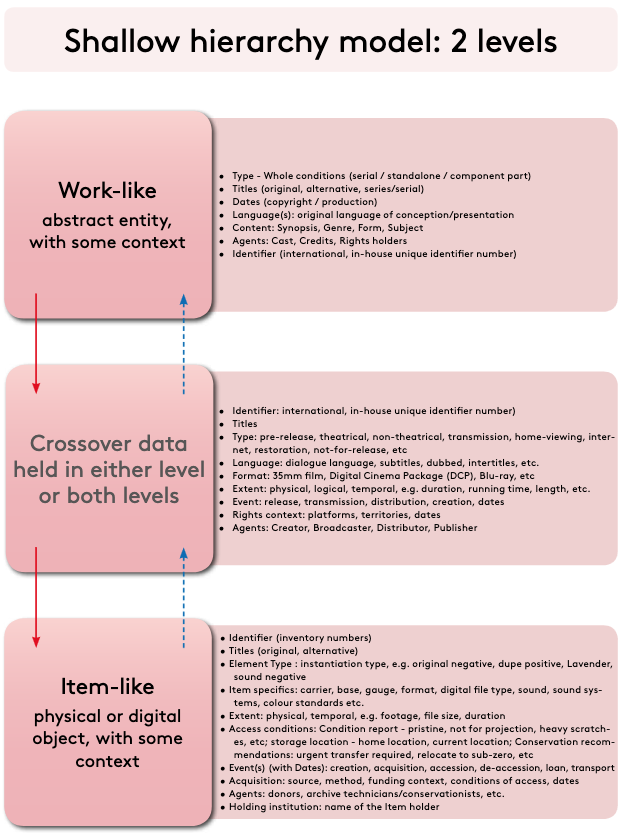

# Collective Access - FIAF Cataloging Rules (2016)

This Github repository contains files for managing a moving image collection using [Collective Access](https://collectiveaccess.org) and cataloging rules as described in [The FIAF Moving Image Cataloging Manual (2016)](https://www.fiafnet.org/pages/e-resources/cataloguing-manual.html).

## About
This setup is currently being developed at [Anthology Film Archives](http://www.anthologyfilmarchives.org) for use as a central cataloging database for our moving image collections. The goal is to develop a two-level hierarchy (Work/Variant and Manifestation/Item) profile that follows the cataloging standards as described in [The International Federation of Film Archives's](http://fiafnet.org) [Moving Image Cataloguing Manual (2016)](https://www.fiafnet.org/pages/e-resources/cataloguing-manual.html) as closely as possible.

## Structure

Model (Manual section 0.2.1, "Shallow hierarchy model: 2 levels"):
* __Tier 1  work_like  = Work-like:__ abstract entity, with some context
* __Tier 2  item_like  = Item-like:__ physical or digital object, with some context
* __Manifestation data__ = "crossover data held in either level or both levels": elements restricted to BOTH work_like and item_like.
* The optional __Variant__ entity is not used.

_Both tiers are ca_objects. Item-like records are created as children of Work-like records. The profile doesn’t enforce this. In CA that is a configuration setting (app.conf), not part of the profile._

_The XML profile file declares base="base", so the standard "base.xml" file has to be present in your installation’s profile directory (ca/install/profiles/xml)._

## Collective Access Installation Profile
This profile was written for [Collective Access 2.0.11](https://collectiveaccess.org/) (CA). 
Instructions for installing CA with an external profile are available in [CA's documentation](https://docs.collectiveaccess.org/providence/user/dataModelling/profiles/).

## Status
In development and testing.

## Contact
* John Klacsmann, Archivist [Anthology Film Archives](http://www.anthologyfilmarchives.org)

